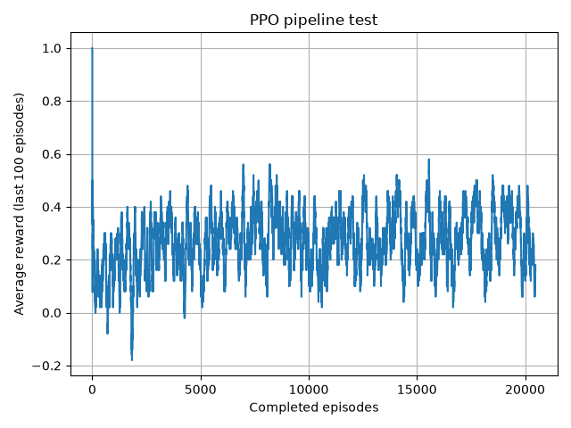

# Micro TFT Learning

Build a Teamfight Tactics agent that learns by **playing itself**, not by imitating human play. Same recipe Riot described publicly at GDC (Ran Cao, "Simulating Teamfight Tactics Using Deep Learning for Fast Reinforcement Learning AI Training").

This repo is a **project-based learning path**. Each project is a small, runnable artifact that adds exactly one concept. The goal is a self-play TFT agent, but the real value is in the ladder.

## Stack

```
env you write  ->  PPO / tabular RL  ->  self-play  ->  scaled TFT
                    (stable-baselines3)  (PettingZoo)   (Project 6)
```

## Progress

| # | Project | Status |
|---|---|---|
| 0 | Tabular Q-learning, Tic-Tac-Toe | done |
| 1 | PPO on CartPole | done |
| 2 | TinyArena, first custom Gym env | done |
| 3 | Spatial board, positioning | done |
| 4 | Economy layer | planned |
| 5 | Multi-agent self-play | planned |
| 6 | Scale to full TFT | planned |

---

## Project 0: Tabular Q-learning on Tic-Tac-Toe

A self-play agent with a plain Q-table, no neural net.

`project0-tictactoe/tic-tac-toe.py`

**Teaches:** the `state -> action -> reward -> update` loop by hand, plus self-play value semantics. A Q-value describes a move for whoever is about to make it, so the next state's value gets negated (the opponent moves next).

**Ships:** an agent that draws against perfect minimax play. Tests assert a hand-computed Q-update (`tic-tac-toe.py:261`).

---

## Project 1: PPO on a standard Gym env

Swap the hand-written loop for Stable-Baselines3 PPO on CartPole-v1.

| File | Purpose |
|---|---|
| `project1-cartpole-ppo/cartpole_ppo.py` | training |
| `project1-cartpole-ppo/evaluate_agent.py` | deterministic eval, mean and std |
| `project1-cartpole-ppo/plot_curve.py` | reward curve from the Monitor CSV |

**Teaches:** reading a training curve to tell "not learning" apart from "learning slowly".

**Result:** `monitor.csv` ends at **500.0**, the environment maximum. Solved.

---

## Project 2: TinyArena, your first Gym environment

A 2-unit, fixed-position, no-movement 1v1 auto-battle. No existing environment to lean on, so you write the `reset`/`step` contract yourself.

| File | Purpose |
|---|---|
| `combat_math.py` | TFT armor formula, `damage = atk * 100 / (100 + armor)` |
| `models.py` | immutable `Unit` and `BattleState` dataclasses |
| `battle_turn.py` | one simultaneous tick (attack or defend) |
| `play_game.py` | full loop outside Gym, 1000 random-vs-random games |
| `env.py` | `TinyArenaEnv(gym.Env)`, `Box` obs, `Discrete(2)` action |
| `eval_random.py` | baseline number to beat |
| `train.py`, `plot.py` | PPO training and curve |

**Teaches:** the Gymnasium API contract (`reset`/`step`, `observation_space`, `action_space`, and the difference between `terminated` and `truncated`), reward shaping, and `Monitor` logging.

**Ships:** PPO clears the random baseline by a wide margin.

| Policy | mean reward | std | win rate |
|---|---|---|---|
| random baseline (200 eps) | `-0.24` | `9.58` | `50.5%` |
| **PPO deterministic (200 eps)** | **`8.08`** | `4.50` | **`91.5%`** |

Training curve goes from `-0.2` to `8.3` over 100k steps.


---

## Project 3: Spatial board, positioning matters

Add a 3x4 board so **where you place** becomes the decision.

| File | Purpose |
|---|---|
| `board.py` | grid, `can_place`, immutable `place`, `print_board` |
| `combat_spatial.py` | `spatial_damage` with a row factor (back row takes `0.85x` with jitter), injectable rng |
| `env.py` | `TinyArenaEnv`, one placement action, full fight simulated in `step` |
| `test_env.py` | Gym contract, seeding, reward mapping (5 tests) |
| `ppo_pipeline_test.py` | PPO run plus brute-force per-cell oracle comparison |
| `play_game.py` | standalone sim and tabular position learner |

**Teaches:** state representation for spatial problems, why the signal must exist in the environment before an agent can exploit it, and how to validate a learned policy when ground truth is computable.

**Verified:**

* Position matters. Back row wins **86.4%** vs front row with randomized stats (`864/1000`).
* `check_env` passes, 5 env tests pass, and seeds reproduce identical fights.
* **Oracle vs PPO.** With 300 paired-seed games per cell, the brute-force per-cell reward table is:
  `(2,3) 0.427, (2,1) 0.427, (2,2) 0.400, (2,0) 0.320` then rows 0-1 around `0.29-0.31`, and all three distance-1 non-back cells tied at `0.080`.
* PPO (20k steps) put `0.483` on `(2,3)`, `0.238` on `(2,1)`, `0.135` on `(2,2)`. **Its top 4 and bottom 3 match the oracle exactly**: it learned "back row, and stay away from the bot's range-1 reach."

**Note:** the episode is a single decision with a constant observation, so this env is effectively a bandit. The oracle solves it optimally; PPO's role was proving the env is Stable-Baselines3 compatible before Project 4.



---

## Roadmap

| # | Project | Teaches |
|---|---|---|
| 4 | Economy layer (gold, shop, level) | Hierarchical and decomposed agents, credit assignment over turns |
| 5 | Multi-agent self-play (PettingZoo, 8 players) | Non-stationary opponents, opponent pools |
| 5.5 | Neural combat surrogate `P(win \| A, B)` | Why tick-by-tick sims are too slow for self-play (the GDC trick) |
| 6 | Scale to full TFT (items, champion pool) | Pure engineering, no new concepts |

## Run

```powershell
.venv\Scripts\Activate.ps1

python project0-tictactoe\tic-tac-toe.py
python project1-cartpole-ppo\cartpole_ppo.py
python project2-tiny-arena\train.py
python project2-tiny-arena\plot.py
python project3-spatial-board\test_board.py
python project3-spatial-board\test_env.py
python project3-spatial-board\ppo_pipeline_test.py
```

## Notes

* Offline only. Nothing here touches the game client, and automating the real client violates Riot's ToS.
* `*.zip`, `*.csv`, and `logs/` are gitignored. Trained models and monitor data are reproducible, not source.
* TFT is a trademark of Riot Games. This is an independent, fan-made project.