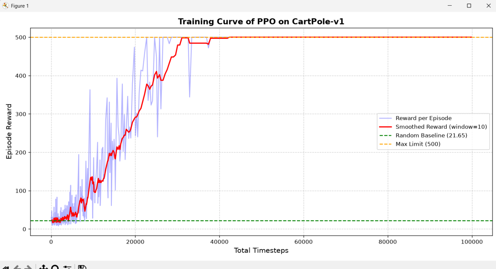

# Project 1 -- PPO on CartPole-v1 (Stable-Baselines3)

Second project in the ladder. Goal: see what the same core RL ideas (state,
action, reward, policy) look like once a library and a neural network handle
the mechanics, after building the tabular version by hand in Project 0.

## Ship criterion
A reward-vs-timesteps training curve that clearly climbs and plateaus -- not
just a single final score.

## Result
- **Random baseline:** 21.65 average reward over 20 episodes
- **Trained agent:** reaches the max possible reward (500) and holds it,
  plateauing by roughly 40,000 timesteps out of 100,000 trained



## Files
- `cartpole_ppo.py` -- environment sanity check, random baseline, and PPO training
- `eval.py` / `evaluate_agent.py` -- loads the trained model and evaluates it
  against the random baseline
- `plot_curve.py` -- reads the Monitor log and produces `training_curve.png`
- `ppo_cartpole_model.zip` -- trained model weights (not committed -- see `.gitignore`)

## Things learned that weren't obvious going in
- `total_timesteps` passed to `.learn()` is a **minimum**, not an exact count --
  PPO always finishes its current rollout (`n_steps`, default 2048) before
  stopping, so a request for 1000 timesteps actually ran 2048.
- `env.reset()` returns `(observation, info)` and `env.step()` returns five
  values `(observation, reward, terminated, truncated, info)` in the current
  `gymnasium` API -- both `terminated` and `truncated` need checking to catch
  every way an episode can end.
- A barely-trained agent's `ep_rew_mean` landing almost exactly on the random
  baseline (both ~21-22) was a good sanity check that the baseline number
  itself was meaningful, before real training made it climb.

## How to run
```
python3 cartpole_ppo.py
python3 plot_curve.py
python3 evaluate_agent.py
```